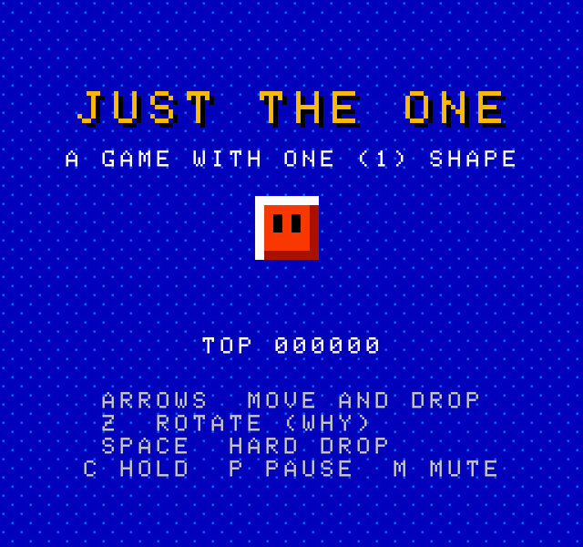
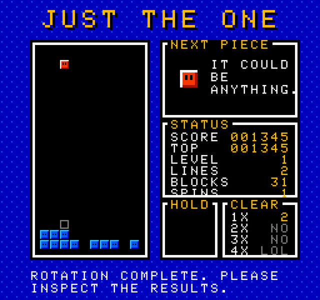
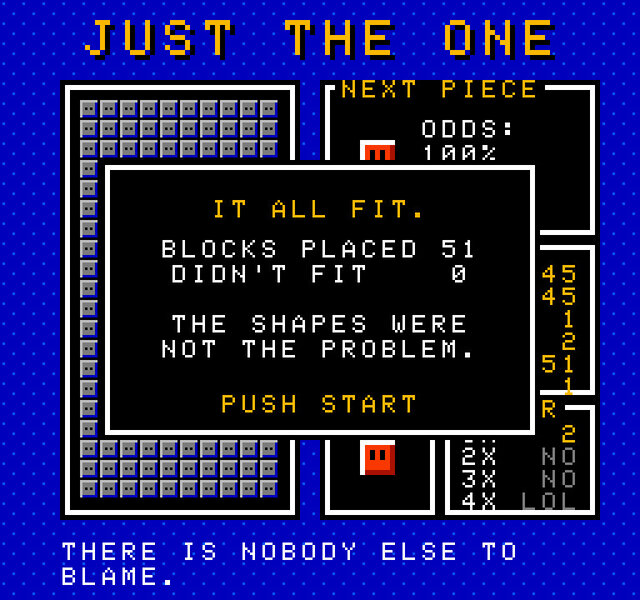

# Just the One

**▶ Play in your browser:** [catchouli.github.io/just-the-one](https://catchouli.github.io/just-the-one/)

A falling-block game with one (1) shape. It's a single square block with a face, and it's the only piece you'll ever get.

Everything you'd expect is there and taken completely seriously. There's a next piece preview that makes a big show of updating to the same block, a hold slot that swaps your block for an identical one, and rotation, which spins it 90 degrees and tells you all about it. The clear table tracks your one, two, three and four-line clears, though only one of those is possible. You can't lose because of a bad piece, so when you do lose there's nobody else to blame.

It's a joke, but it plays properly: it has hard drop, soft drop, a ghost piece, lock delay, held-key auto-repeat, levels that speed up every five lines, chiptune sound effects and a saved high score.

## Controls

| Key | Does |
| --- | --- |
| ← → | Move |
| ↓ | Soft drop |
| Space | Hard drop |
| Z, X or ↑ | Rotate (why) |
| C or Shift | Hold |
| P, Enter or Esc | Start and pause |
| M | Mute |

On a phone you get an on-screen pad instead.

## Running it locally

It's one self-contained `index.html` with no dependencies, so just open it in a browser.
